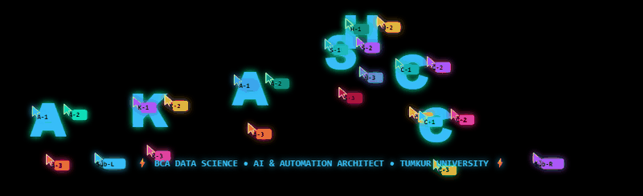
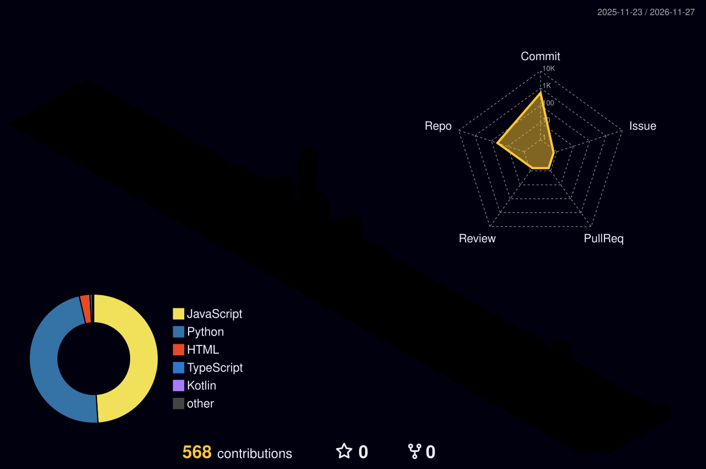

<!-- 🔮 Dynamic Rotating Banner: Swarm Rebuilt ⇄ Ruby Red Laser Writer -->

<!-- Typing SVG Header -->

  <b>Passionate about building AI-powered web applications, serverless automation bots, and data-driven solutions.</b>

  
  
  
  

  
  

---

## 👨‍💻 About Me

- 🎓 **Education:** Pursuing **BCA in Data Science** (2024–2027) at **University College of Science, Tumkur University**.
- 💡 **Core Expertise:** Developing end-to-end AI applications, serverless automation bots, and data intelligence pipelines.
- 🚀 **Specialization:** Building scalable backends with **Python, Gunicorn & Render**, integrating **Google Gemini API**, **Whisper transcription**, and deploying edge workers via **Cloudflare Workers**.
- 🏅 **Beyond the Screen:** Represented **Tumkur University** in **All India-Level Yoga Competition** (2025–2026) and active intercollegiate badminton player.
- 🎯 **Career Goal:** Aspiring AI/ML Engineer and Data Analyst passionate about turning cutting-edge models into production tools.

---

## 🛠️ Tech Stack & Skills

<table>
  <tr>
    <td align="center" width="22%"><b>Languages</b></td>
    <td>
      
      
      
      
      
      
      
    </td>
  </tr>
  <tr>
    <td align="center"><b>AI & Automation</b></td>
    <td>
      
      
      
      
      
      
      
    </td>
  </tr>
  <tr>
    <td align="center"><b>Web & Backend</b></td>
    <td>
      
      
      
      
      
      
    </td>
  </tr>
  <tr>
    <td align="center"><b>Cloud & Serverless</b></td>
    <td>
      
      
      
      
      
    </td>
  </tr>
  <tr>
    <td align="center"><b>Data Analytics & Tools</b></td>
    <td>
      
      
      
      
      
      
      
    </td>
  </tr>
</table>

---

## 🚀 Featured Projects

<!-- 🚀 WOW Feature 2: Live Graphical Interactive Repository Cards -->

  
  &nbsp;
  

  <b>🌐 CC AI Platform Live:</b> <a href="https://ccdev44.netlify.app/"><b>Open ccdev44.netlify.app ↗</b></a> 
  • <i>Multimodal AI platform with Gemini API, Whisper transcription & streaming responses</i>

  
  &nbsp;
  

  <b>⚡ Cloud & 3D Engineering:</b> Remote MCP Server for Claude & Antigravity (Render) • 3D Interactive Campus Walkthrough (Three.js & WebGL)

 

| Project | Tech Stack | Highlights & Repositories |
| :--- | :--- | :--- |
| **🤖 WhatsApp & Telegram Automation Bots** | `Python` `Node.js` `Cloudflare Workers` `Gemini Flash API` | Serverless edge bots with Gemini Flash API for bilingual chat, personalized alerts, and instant media utilities. 📂 **[Bot Repo](https://github.com/Akashcc702/reels_downloader_bot1-4-26)** • **[Telegram Bot](https://github.com/Akashcc702/YT_Best-ved_post_TB)** |
| **🧠 MNIST Digit Classifier & AI Image Studio** | `JavaScript` `Canvas` `Hugging Face` `Python` | Interactive handwritten digit classification in HTML5 Canvas + AI text-to-image generation pipeline via Hugging Face. 📂 **[MNIST Canvas Demo](https://github.com/Akashcc702/MNIST-model0.3)** • **[Image Gen Pipeline](https://github.com/Akashcc702/cc_pic0.3-free-hf-)** |
| **🎮 Interactive 3D Web & Game Graphics** | `JavaScript` `Three.js` `WebGL` `HTML5` | Browser-based 3D room environment and game physics built with Three.js. 📂 **[3D Room Environment](https://github.com/Akashcc702/room-horror-game-3D-)** |

---

## 📜 Certifications & Achievements

<table>
  <tr>
    <td width="50%">
      <h3>🎓 Professional Certifications</h3>
      <ul>
        <li>
          <b>Innovating with Google Cloud AI</b> 
          <i>Google Cloud</i> — Generative AI fundamentals & vertex workflows. 
          🔗 <a href="https://drive.google.com/file/d/1mP0fDke11ypc6jmMqDF1xEq9yujiHvFb/view?usp=sharing"><b>View Certificate ↗</b></a>
        </li>
         
        <li>
          <b>Machine Learning Using Python</b> 
          <i>Data Science / ML</i> — Supervised & unsupervised predictive models. 
          🔗 <a href="https://drive.google.com/file/d/1f4YexyFfjTnJnw1kP49AplaS9Aheu0yx/view?usp=sharing"><b>View Certificate ↗</b></a>
        </li>
         
        <li>
          <b>MS Office Suite & Productivity</b> 
          <i>Infosys Springboard</i> — Data modeling & advanced business spreadsheets. 
          🔗 <a href="https://drive.google.com/file/d/1SxS4hdte2XOV9n6djhyjnBjoOjUtRUKE/view?usp=sharing"><b>View Certificate ↗</b></a>
        </li>
      </ul>
    </td>
    <td width="50%">
      <h3>🏆 Sports & University Honors</h3>
      <ul>
        <li>
          <b>All India-Level Yoga Competition (2025–2026)</b> 
          Proudly represented <b>Tumkur University</b> at the national collegiate championship.
        </li>
         
        <li>
          <b>Intercollegiate Badminton Competition</b> 
          Represented <b>University College of Science, Tumakuru</b> in state-level university tournaments.
        </li>
         
        <li>
          <b>Active Open-Source Contributor</b> 
          <b>540+ Contributions</b> in the last year across 40+ repositories.
        </li>
      </ul>
    </td>
  </tr>
</table>

---

## 📊 GitHub Analytics & Real-Time Activity

  
  &nbsp;&nbsp;
  

  

---

<!-- 🏙️ WOW Feature 3: 3D Isometric Contribution Graph & Snake Combo -->
## 🏙️ 3D Contribution Landscape & Activity

  <picture>
    <source media="(prefers-color-scheme: dark)" srcset="https://raw.githubusercontent.com/Akashcc702/Akashcc702/main/profile-3d-contrib/profile-night-rainbow.svg">
    <source media="(prefers-color-scheme: light)" srcset="https://raw.githubusercontent.com/Akashcc702/Akashcc702/main/profile-3d-contrib/profile-green.svg">
    
  </picture>

 

  <picture>
    <source media="(prefers-color-scheme: dark)" srcset="https://raw.githubusercontent.com/Akashcc702/Akashcc702/output/github-contribution-grid-snake-dark.svg">
    <source media="(prefers-color-scheme: light)" srcset="https://raw.githubusercontent.com/Akashcc702/Akashcc702/output/github-contribution-grid-snake.svg">
    
  </picture>
  
<i>3D Isometric City & Contribution Snake generated automatically via GitHub Actions</i>

---

## 💬 Get in Touch & Collaborate!

I am actively looking for **Internships**, **Open-Source Collaborations**, and **AI/ML / Data Science Opportunities**! Feel free to connect:

 

&nbsp;&nbsp;

&nbsp;&nbsp;

  

⭐ *“Turning ideas into intelligent, automated reality.”* ⭐

